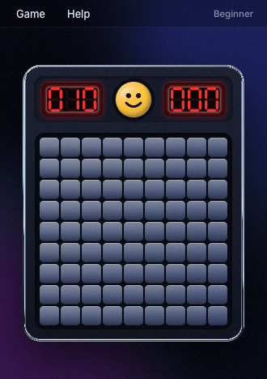
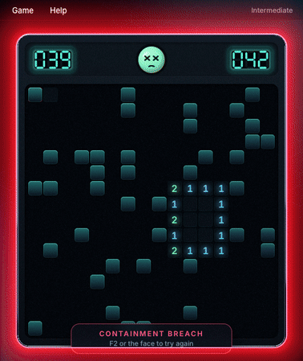
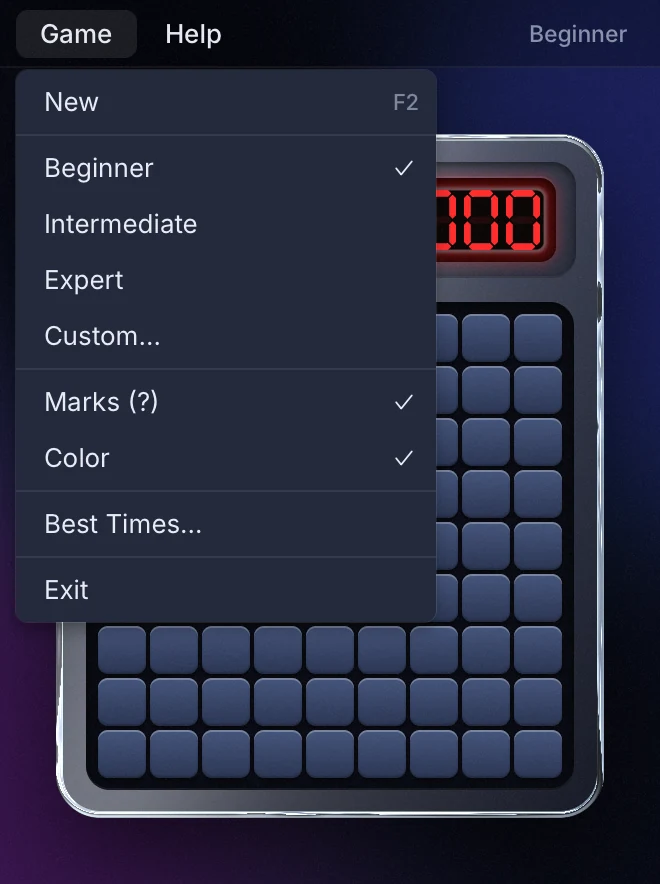

# Runesweeper

Minesweeper with the rules, menus and quirks of the Windows classic, drawn on the GPU with
[Rune](https://github.com/anomalyco/rune): springs, ripples, liquid-metal chrome, plastic, fire
and shockwaves.

<p align="center">
  
  
</p>

<p align="center">
  
</p>
<p align="center">
  
  
</p>
<p align="center">
  
  
</p>

## What moves, and what doesn't

Motion follows Emil Kowalski's rule of thumb: the more often you see something, the less it
moves. Every animation here had to justify itself (the `remove-animations` skill), and most
that couldn't were cut.

- **Every click** (hundreds a game): the tile lifts off in 240 ms, rippling out from the click
  over at most 300 ms. Numbers are there at once; nothing makes you wait to read them. The
  selector sits on the square under the pointer, with no glide to lag behind it.
- **Flags**: a 150 ms fade. **Keys** (arrows, Space, F, F2) never animate.
- **A new field** from the face or the menu deals in from the centre in under half a second;
  from F2 it's simply there.
- **A loss**: one shockwave through the window and the other mines going off in a 300 ms chain
  out from the one you hit, then still.
- **A win** (rare, so it gets the flourish): flagged tiles turn gold, a swell runs across the
  field, stars burst off the face and the console glows. Beat your best and the timer turns gold.
- The result banner straddles the field's edge, says how it went, and leaves after 3 s.
- Shaders do the backdrop, the liquid-metal rim, the plastic face, the LED glow, the blasts and
  the glow, and hold still when nothing is happening: an idle window draws nothing.
- Entrances and exits use a strong ease-out; nothing grows from nothing. With Reduce Motion on,
  travel and bounce are off.
- Small windows and phones get the whole console, scaled to fit.

Motion is checked with Rune's motion gate (pops, jumps, snaps, overshoot that wasn't meant):

```sh
RUNE_MOTION_GATE=gate.txt runesweeper --scene beginner --script scripts/play.json --duration 4.5 --out frames
RUNE_MOTION_GATE=gate.txt runesweeper --scene lost --duration 4 --out frames   # also: keys.json, won, first-run
```

## Download

Builds of the latest commit are on the [Latest build](https://github.com/nicognaW/runesweeper/releases/tag/latest)
release; tagged versions are on [Releases](https://github.com/nicognaW/runesweeper/releases).

| System | File | Install |
| --- | --- | --- |
| Windows 10/11 (x64) | `runesweeper-windows-x86_64.zip` | Unzip, run `runesweeper.exe`. SmartScreen may warn on an unsigned app: *More info → Run anyway*. |
| macOS 12+ (Apple silicon and Intel) | `runesweeper-macos-universal.dmg` | Open, drag Runesweeper to Applications. First launch: right-click the app → *Open* (it is not notarized). |
| Linux (x64) | `runesweeper-linux-x86_64.tar.gz` | `tar xzf runesweeper-linux-x86_64.tar.gz && ./runesweeper-linux-x86_64/install-linux.sh`, or run `./runesweeper` in place. Needs Vulkan and `libxkbcommon-x11`. |
| Web | [nicognaw.github.io/runesweeper](https://nicognaw.github.io/runesweeper/) or `runesweeper-web.zip` | Needs WebGPU (recent Chrome or Edge; Safari 26+). Serve the zip's folder over HTTPS or `localhost`. |

## Play

The same game as Windows Minesweeper:

- **Left click** opens a square. Press and drag: the square under the pointer stays sunk until you let go, and the face gasps.
- **Right click** cycles flag → `?` → blank (`?` only with *Game ▸ Marks*).
- **Keyboard**: arrows move the selector, Space opens (or chords on a number), F flags, F2 starts again.
- **Touch** (the web build): the *Flag* button in the menu bar makes taps place flags; a tap on a number chords.
- **Chord**: on a number whose flags are all placed, press both buttons (or the middle one) to open its other neighbours. A wrong flag loses.
- The first click is never a mine: one that was there moves to the top-left-most free square.
- The mine counter is mines less flags and goes negative. The timer starts on the first click, at 1, and stops at 999.
- Losing shows every mine, crosses out wrong flags and marks the one you hit in red. Winning flags the rest.
- **Game** menu: New (F2), Beginner (9×9, 10), Intermediate (16×16, 40), Expert (30×16, 99), Custom (9–24 × 9–30, up to (h−1)(w−1) mines), Marks, Color, Best Times, Exit.
- **Best Times** keeps the fastest name per level; beat one and you're asked for your name.
- The face starts a new game. `xyzzy`, then Shift+Enter, turns on the old corner-pixel cheat.

Settings and best times are saved to `%APPDATA%\runesweeper`, `~/Library/Application Support/runesweeper`,
`~/.config/runesweeper`, or the browser's local storage.

`--plain` (desktop) or `?plain` (web) turns the shader effects off for weak GPUs.

## Build

Rust 1.97 or newer.

```sh
cargo run --release
```

Linux needs `libxkbcommon-dev libwayland-dev` to build. The web build uses Rune's script
(clone Rune at the rev in `Cargo.toml`):

```sh
rustup target add wasm32-unknown-unknown
cargo install wasm-bindgen-cli --version <version in Cargo.lock> --locked
path/to/rune/scripts/web-build.sh runesweeper --out dist/web --no-html && cp web/index.html dist/web/
```

### Headless

Every Rune app renders without a window, which is how the pictures above were made:

```sh
runesweeper --list-scenes
runesweeper --snap expert.png --scene expert --size 868x598 --scale 2
runesweeper --scene beginner --script scripts/play.json --video play.mp4
```

## Agent skills

`.claude/skills/` holds the design, animation and engineering skills agents use on this repo;
[`SOURCES.md`](.claude/skills/SOURCES.md) lists where each comes from. Two packs whose licenses
don't allow republishing are installed with `scripts/install-skills.sh`.

## Layout

- `src/game.rs`: the rules, with tests.
- `src/app.rs`: state, input (press, chord, flag), the clock, keys.
- `src/board.rs`, `src/ui.rs`, `src/icons.rs`, `src/style.rs`: the view, vector art and palettes.
- `src/gfx.rs`: the compositor that turns effect slots into `rune-fx` shaders.
- `vendor/rune-fx`: Rune's effects crate with a one-line fix so it builds for wasm.

MIT. Rune is MIT, © Anomaly. Not affiliated with Microsoft.
