# Runesweeper

Minesweeper with the rules and quirks of the Windows classic, drawn on the GPU with
[Rune](https://github.com/anomalyco/rune): springs, ripples, liquid-metal chrome, plastic, fire
and shockwaves. Beyond Classic, it has three modes that lay the field after your first click
(Gentle No Guess, No Guess, Max Guess), a Hint that teaches the next move in four steps,
a History of every game with a Review of any of them, and the whole game in English and
简体中文.

<p align="center">
  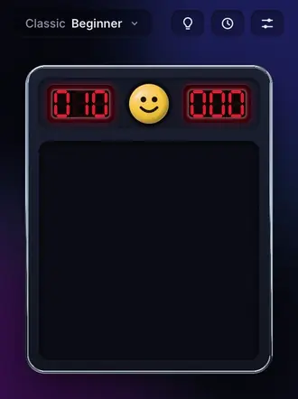
  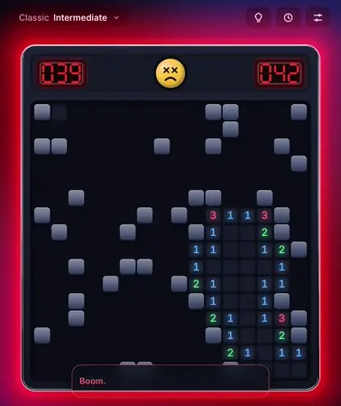
</p>

<p align="center">
  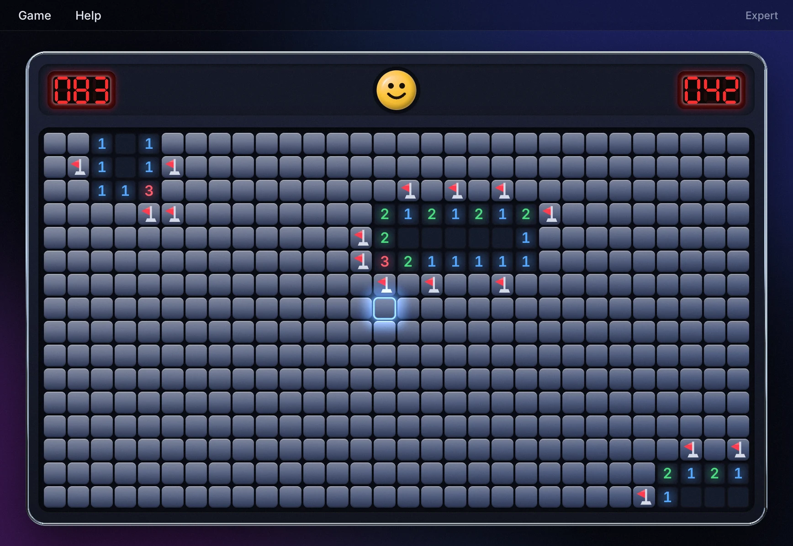
</p>
<p align="center">
  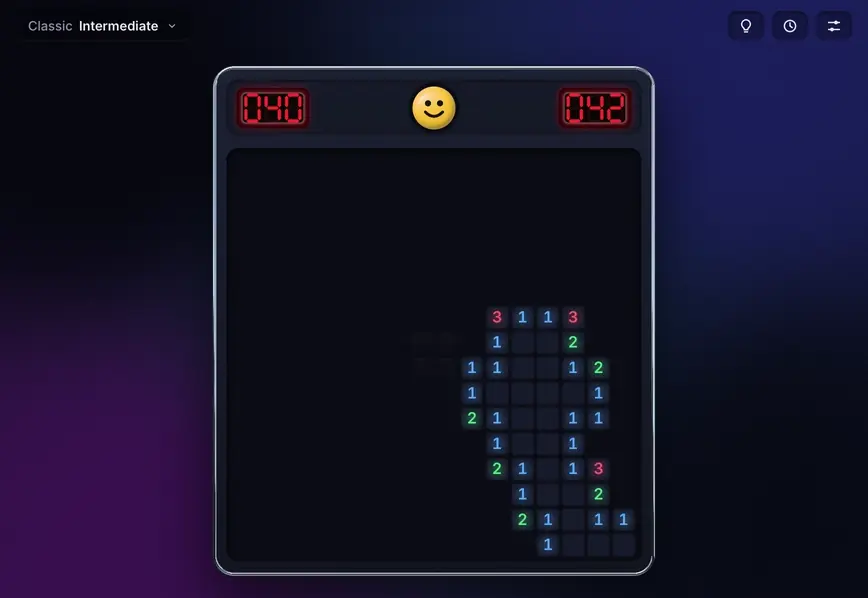
</p>
<p align="center">
  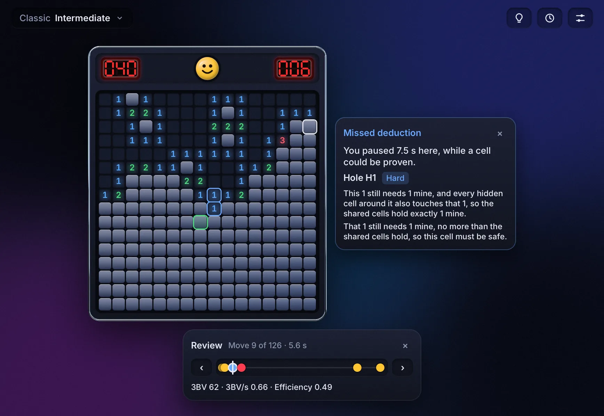
  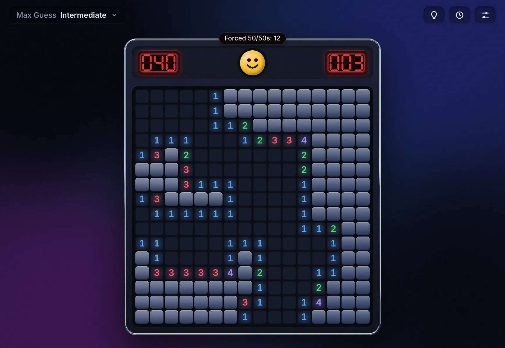
</p>
<p align="center">
  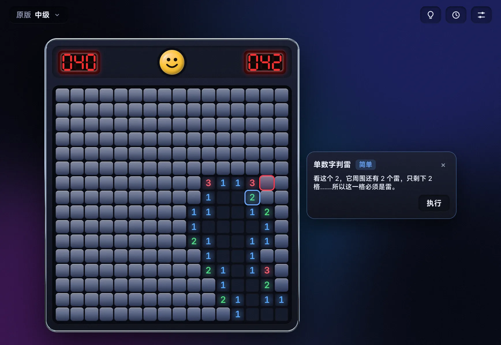
  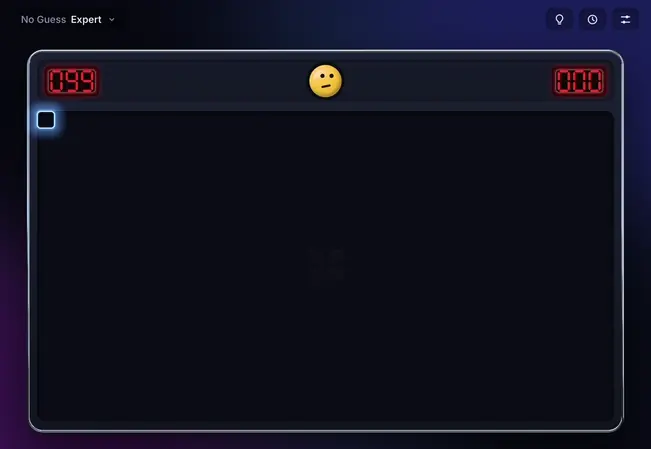
</p>
<p align="center">
  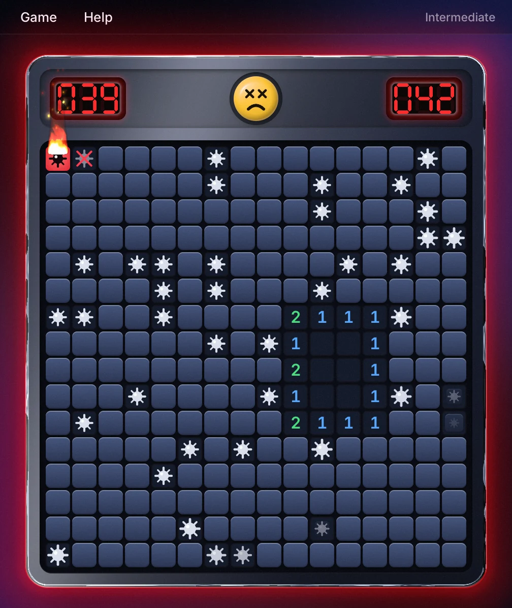
  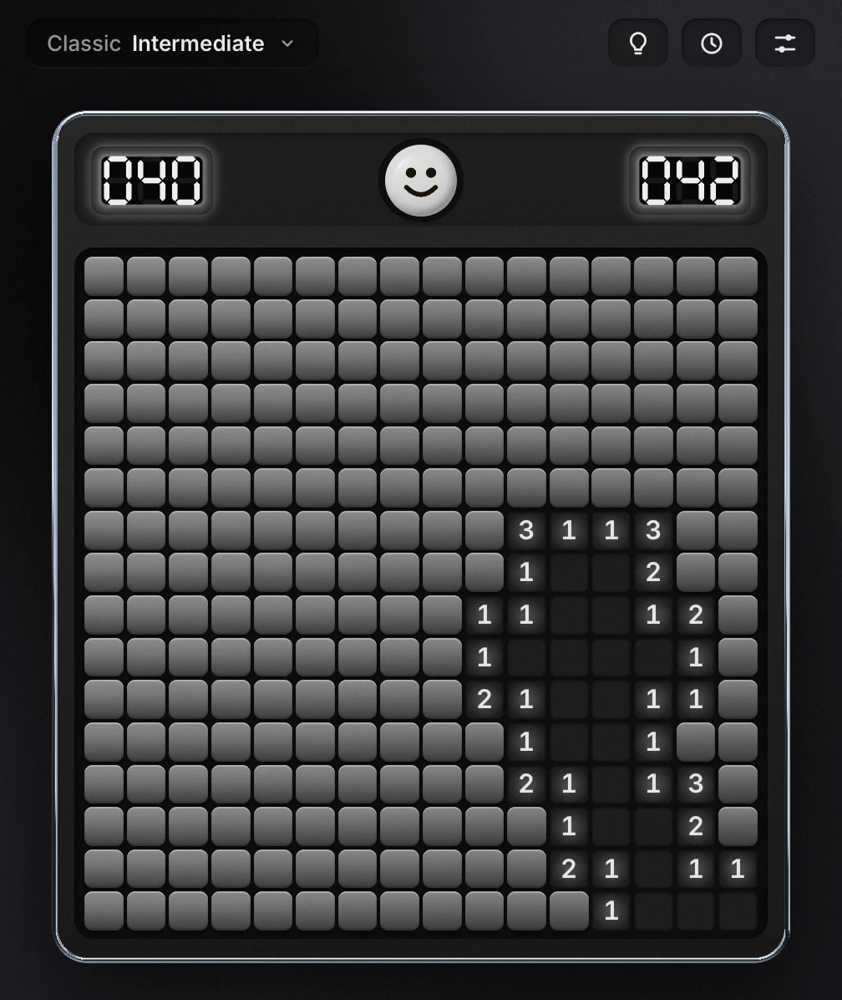
  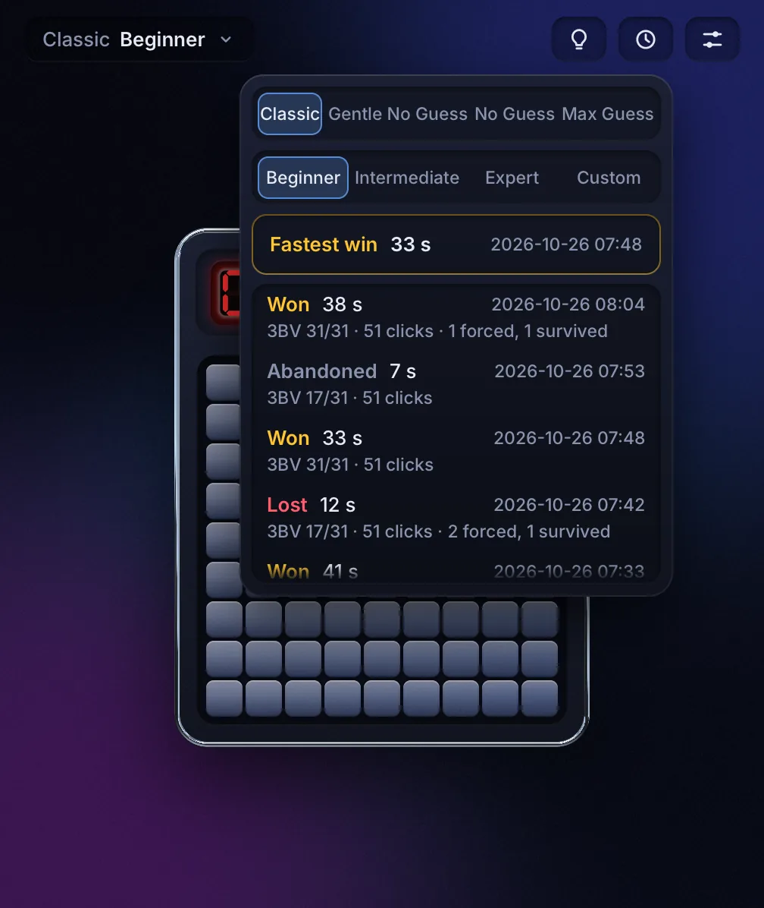
</p>
<p align="center">
  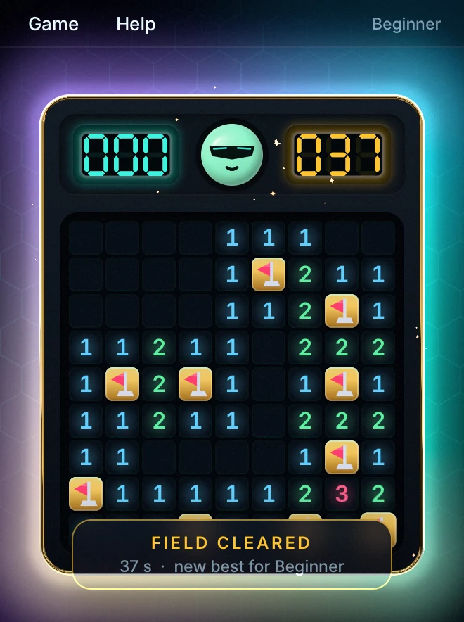
  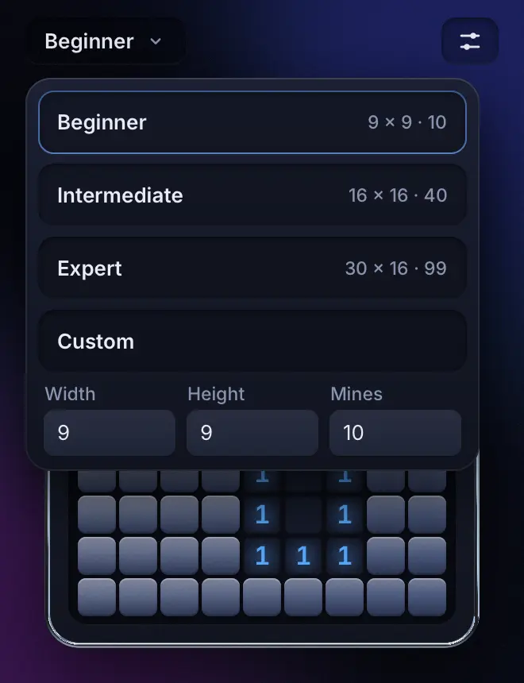
</p>

## What moves, and what doesn't

Motion follows Emil Kowalski's rule of thumb: the more often you see something, the less it
moves. Every animation here had to justify itself (the `remove-animations` skill), and most
that couldn't were cut.

- **Every click** (hundreds a game): the tile lifts off in 240 ms, rippling out from the click
  over at most 300 ms. Numbers are there at once; nothing makes you wait to read them. The
  selector sits on the square under the pointer, with no glide to lag behind it.
- **Flags**: a 150 ms fade. **Keys** (arrows, Space, F, F2, Escape) never animate.
- **Panels** (the picker, History, Settings) are opened now and then, so they slide down from the
  toolbar in about 0.2 s; Escape closes one in the same frame. The Hint's callout changes in place
  as H steps it.
- **A new field** from the face or the picker deals in from the centre in under half a second;
  from F2 it's simply there, old field gone in the same frame.
- **A field that takes its time** (the no-guess modes generate after the first click, off the UI thread):
  the face thinks at once, the field holds still, and only past 600 ms does a slow band of light
  sweep the hidden tiles, stopping in the frame the field is ready. Quick fields show nothing
  but the face. With Reduce Motion the light breathes in place instead of travelling.
- **A loss**: one shockwave through the window and the other mines going off in a 300 ms chain
  out from the one you hit, then still.
- **A win** (rare, so it gets the flourish): flagged tiles turn gold, a swell runs across the
  field, stars burst off the face and the console glows. Beat your best and the timer turns gold.
- The result banner straddles the field's edge, says how it went, and leaves after 3 s; its
  Review action stays behind as a small tab on the console's bottom rim.
- **A Review** (from that action, or any game in History) walks the game on the field, with a
  timeline under it marking needless guesses, missed deductions (a pause over 5 s while a cell
  could be proven), forced guesses (true 50/50 or not) and clicks a chord would have saved, plus
  3BV, 3BV/s and efficiency. Selecting a marker sets the field to that moment and gives the
  reason as a hint would, in the hint's words and with no odds. Arrow keys step at once; a step
  forward lifts the tiles that move opened, as a click does.
- Shaders do the backdrop, the liquid-metal rim, the plastic face, the LED glow, the blasts and
  the glow, and hold still when nothing is happening: an idle window draws nothing.
- Entrances and exits use a strong ease-out; nothing grows from nothing. With Reduce Motion on,
  travel and bounce are off.
- Small windows and phones get the whole console, scaled to fit.

Motion is checked with Rune's motion gate (pops, jumps, snaps, overshoot that wasn't meant):

```sh
RUNE_MOTION_GATE=gate.txt runesweeper --scene beginner --script scripts/play.json --duration 4.5 --out frames
RUNE_MOTION_GATE=gate.txt runesweeper --scene lost --duration 4 --out frames   # also: keys.json, panels.json, won, picker
```

Every scenario reports nothing except the scripts that press a key with something to remove:
F2 in `play.json` and `keys.json`, where the one-frame swap shows up as the old field's tiles
leaving unanimated, and Escape in `panels.json`, where the picker leaves the same way. Both are
deliberate cuts for a keyboard action.

Frame cost stays small: `cargo run --release --example bench` times Rune's work per frame on
Expert (view, diff, layout, draw lists) at 0.4 ms median and 0.7 ms p95, even while a press is
dragged across the field. Nothing redraws at rest, and the shockwave's full-window backdrop copy
exists only for its 0.6 s.

## Solver

A bot plays every cell it can prove, then the hidden cell least likely to be a mine. On
Expert it wins **37.3%** of games (95% Wilson interval 36.4–38.3%), guessing 3.74 times per
win; 4.5% of games are won without a single guess; a game takes 1.6 ms.

The rules: Classic Expert (30×16, 99 mines), 10,000 fields dealt one after another from the
MSVC `rand()` stream seeded with 1, first click on the top-left cell. A mine there moves to
the first free cell as XP moves it, so the click is safe but need not open an area. This is
not the rule behind published "safe first click" figures (Tu et al.'s 40.06%, for one),
where the first cell's mine goes anywhere else on the field. The bot's odds assume every
layout equally likely and ignore the relocation's bias toward the top left.

No Guess draws uniform fields, with the 3×3 around a first click anywhere on the field kept
clear, until the bot clears one without guessing; there is no time limit and no mine is moved,
so an accepted field is a uniform draw over the fields logic can finish. Over 1,000 fields per
level (seed 1, release build, one native core):

| Level | Fields accepted | Generation p50 | p99 |
| --- | --- | --- | --- |
| Beginner | 89.9% | 0.08 ms | 0.27 ms |
| Intermediate | 70.7% | 0.42 ms | 1.8 ms |
| Expert | 15.3% | 5.3 ms | 31 ms |

The bot then wins every one of them without a guess.

Gentle No Guess is the same with the bot at Gentle strength: one number alone, two overlapping
numbers, and the count of mines left only once 12 or fewer cells are unresolved. Same rules:

| Level | Fields accepted | Generation p50 | p99 |
| --- | --- | --- | --- |
| Beginner | 88.5% | 0.04 ms | 0.13 ms |
| Intermediate | 69.5% | 0.34 ms | 1.3 ms |
| Expert | 13.2% | 5.3 ms | 35 ms |

The Gentle bot then wins every one of them without a guess.

The web build generates in a worker; its wasm (the site's own build, run by Node's V8, same
fields and seed) takes:

| Level | No Guess p50 | p99 | Gentle No Guess p50 | p99 |
| --- | --- | --- | --- | --- |
| Beginner | 0.08 ms | 0.30 ms | 0.09 ms | 0.35 ms |
| Intermediate | 0.53 ms | 2.1 ms | 0.60 ms | 2.6 ms |
| Expert | 7.2 ms | 43 ms | 7.5 ms | 46 ms |

Max Guess searches instead of redrawing. From the uniform field No Guess would draw first, it
moves one mine at a time and walks the field as a perfect, lucky player: every proof, and at
each stall a true 50/50, opening its safe cell. A true 50/50 is two cells that hold one mine in
every arrangement the numbers and the mine count allow, where every other cell that is or may
become a number touches both or neither. A move stays when the walk does no worse: a finished
field beats one that stalls on a lopsided guess, then more true 50/50s win, then more ground
opened. The best finished field after a fixed number of steps is used (Beginner 2,000,
Intermediate 1,500, Expert 1,000; Custom in proportion to its cells), so a field is the same on
every machine. Each pair's mine then goes to either cell on a coin flip, so neither cell of a
pair is the safer one. As solver stress tests, over 1,000 fields per level (seed 1, the bot
playing each once):

| Level | True 50/50s per field (most) | Bot wins (95% Wilson) | Perfect play, mean 0.5^k | Bot time per game | Generation p50 | p99 |
| --- | --- | --- | --- | --- | --- | --- |
| Beginner | 3.41 (4) | 9.4% (7.7–11.4%) | 10.2% | 0.06 ms | 91 ms | 123 ms |
| Intermediate | 7.88 (15) | 1.3% (0.8–2.2%) | 1.2% | 0.36 ms | 420 ms | 725 ms |
| Expert | 10.24 (19) | 0.4% (0.2–1.0%) | 0.5% | 1.6 ms | 807 ms | 1.36 s |

The bot wins as often as perfect play can: every guess it is forced into is a coin flip.
On wasm (Node's V8, the release wasm through `wasm-bindgen`, 100 fields per level, seed 1)
generation takes p50 107 ms / p99 153 ms on Beginner, 467 / 826 ms on Intermediate and
983 ms / 1.49 s on Expert: past 600 ms the sweep shows it is working.

```sh
cargo run --release --example solver -- 10000 1 1000 1000   # Classic games per level, seed, fields per mode, Max Guess fields
```

It prints the same columns for Beginner and Intermediate; the same seed gives the same numbers.
`scripts/web-build.sh && node scripts/wasm-bench.mjs dist/web 1000 1` measures the wasm
(a fourth argument, such as `max-guess`, picks the modes).

## Download

Builds of the latest commit are on the [Latest build](https://github.com/nicognaW/runesweeper/releases/tag/latest)
release; tagged versions are on [Releases](https://github.com/nicognaW/runesweeper/releases).

| System | File | Install |
| --- | --- | --- |
| Windows 10/11 (x64) | `runesweeper-windows-x86_64.zip` | Unzip, run `runesweeper.exe`. SmartScreen may warn on an unsigned app: *More info → Run anyway*. |
| macOS 12+ (Apple silicon and Intel) | `runesweeper-macos-universal.dmg` | Open, drag Runesweeper to Applications. First launch: right-click the app → *Open* (it is not notarized). |
| Linux (x64) | `runesweeper-linux-x86_64.tar.gz` | `tar xzf runesweeper-linux-x86_64.tar.gz && ./runesweeper-linux-x86_64/install-linux.sh`, or run `./runesweeper` in place. Needs Vulkan and `libxkbcommon-x11`. |
| Web | [runesweeper.nkk.sh](https://runesweeper.nkk.sh), [nicognaw.github.io/runesweeper](https://nicognaw.github.io/runesweeper/) or `runesweeper-web.zip` | Needs WebGPU (recent Chrome or Edge; Safari 26+). Serve the zip's folder over HTTPS or `localhost`. |

## Play

The same game as Windows Minesweeper:

- **Left click** opens a square. Press and drag: the square under the pointer stays sunk until you let go, and the face gasps.
- **Right click** cycles flag → `?` → blank (`?` only with *Marks* on in Settings).
- **Keyboard**: arrows move the selector, Space opens (or chords on a number), F flags, H asks for a hint, F2 starts again, Escape closes a panel, the hint or a review.
- **Touch** (the web build): the flag toggle on the toolbar makes taps place flags while it is lit; a tap on a number chords.
- **Chord**: on a number whose flags are all placed, press both buttons (or the middle one) to open its other neighbours. A wrong flag loses.
- Mines come from the Microsoft C runtime's `rand()`, seeded once per session from a millisecond clock, as `srand(GetTickCount())`: a column, then a row, each `rand() % n`, redrawn while the square already holds a mine.
- A first click on a mine moves it to the first free square reading from the top left, skipping the last row and column as Windows does. If that area is all mines, nothing happens and the next click is still a first click.
- The mine counter is mines less flags and goes negative. The timer starts on the first click, at 1, and stops at 999.
- Losing shows every mine, crosses out wrong flags and marks the one you hit in red. Winning flags the rest.
- **Modes**: Classic (原版) is everything above, unchanged. In **No Guess** (无猜) no mines exist until your first click; the field is then laid with the 3×3 around the click clear, so it always opens an area, and redrawn until perfect logic (the mine count included) can finish it from there. The field is fully determined by mode, level, seed and first click. It is generated off the UI thread (a thread on desktop, a web worker in the browser), so the window never freezes; F2 or the face cancels it for a fresh field. The timer starts once the field is ready. **Gentle No Guess** (简单无猜) works the same, but only keeps fields that one number, or two overlapping numbers, at a time can finish, with the mine count near the end: pattern play always wins. **Max Guess** (死猜挑战) lays its field the same way, then searches for one that forces a perfect player into as many **true 50/50s** as it can: two cells holding one mine that no number, now or later, can ever tell apart. Everything between them is logic. Once your first click has laid the field, a tab on the console's top edge shows how many it holds; the result banner says how many you got through and, when you lost on one, that it was forced. There is no undo.
- **Toolbar**: the chip on the left shows the Mode and Level and opens the picker: the four Modes two to a row, then Beginner (9×9, 10), Intermediate (16×16, 40), Expert (30×16, 99) or Custom, whose width (9–30), height (9–24) and mines (up to (w−1)(h−1)) are typed in place; Enter or the Custom row starts it. Picking starts a new field at once. On the right: the flag toggle (touch only), then Hint, History and Settings.
- **Hint** (the bulb, or H), in every mode and as often as you like, with no time penalty. Each press goes one step deeper: the technique and its grade (Easy, Medium, Hard, Evil), then the numbers it reads ringed, then the cell and whether it is safe or a mine, then the reason in words with Apply, which plays the move. Any move starts the next hint afresh; Escape or × closes it. It reads only the open numbers, never your flags, except to say first when a flag is provably wrong. It names the pattern when there is one (1-1, 1-2, 1-2-1, 1-2-2-1, holes, triangles, the corners, reduction, mine counting and the rest of minesweeper.online's catalogue, with the Chinese community's 定式 names in 简体中文), and otherwise explains with the fewest numbers that prove the cell. When nothing can be proven it teaches the guess: a true 50/50 (take it now), a cell that can only lead to another guess (avoid it), a few countable arrangements, fewer-mine arrangements, a cell likely to open an area, and in Classic the top-left corner that XP's first-click move makes riskier. If no such reason applies it says only that a guess is needed. It never shows a probability. A game with a hint shown is recorded as assisted.
- **History** (the clock): every game won, lost or abandoned after its first click, newest first, filtered by Mode and Level, with the fastest win for that Mode and Level on top. Each row has the date and time, result, seconds, 3BV, clicks, hints and forced guesses faced and survived. Beat the fastest win and the timer turns gold. Records are kept without limit.
- **Review**: the result banner's Review button (a tab on the console's bottom rim once the banner leaves), or any row in History, replays that game on the field. The timeline under it marks needless guesses, missed deductions, forced guesses and clicks a chord would have saved; ‹ › or the left and right arrows step, and selecting a marker shows the field at that moment with the reason in the hint's words. It also gives 3BV, 3BV/s and efficiency (3BV per click). Escape, F2 or × leaves it; a review never changes the record.
- **Settings** (the sliders): Marks (?), Color and Language (English or 简体中文). The first launch follows the system language (the browser's on the web): any Chinese locale means 简体中文. Chinese is drawn in Xiaomi's MiSans and Latin letters and digits in Inter, both built in, so Chinese shows on any machine and in the browser.
- The face starts a new game. `xyzzy`, then Shift, turns the old corner-pixel cheat on or off.

Settings, History (`history.txt`, one game per line) and the game in play are saved to
`%APPDATA%\runesweeper`, `~/Library/Application Support/runesweeper`, `~/.config/runesweeper`, or
the browser's local storage.

`--plain` (desktop) or `?plain` (web) turns the shader effects off for weak GPUs.

## Build

Rust 1.97 or newer.

```sh
cargo run --release
```

Linux needs `libxkbcommon-dev libwayland-dev` to build. The web build installs what it needs
(the wasm target, the matching `wasm-bindgen` CLI, Rune's build script) and writes `dist/web`:

```sh
scripts/web-build.sh
```

### Headless

Every Rune app renders without a window, which is how the pictures above were made:

```sh
runesweeper --list-scenes
runesweeper --snap expert.png --scene expert --size 868x598 --scale 2 --at 3
runesweeper --scene beginner --script scripts/play.json --size 330x442 --video play.mp4
runesweeper --scene intermediate --script scripts/hint.json --size 868x598 --keys --video hint.mp4
```

The stills are `expert`, `review`, `max-guess` and `hint-zh-cn` at 868×598, `lost`, `mono` and
`history` at 504×598, and `won` and `picker` at 330×442, all at scale 2 and 3 s in. The
animations are the two scripts above, `lost` for 2 s at 504×598 and `generating` for 2.6 s at
868×598, encoded as animated WebP with ffmpeg's `libwebp_anim`.

## Agent skills

`.claude/skills/` holds the design, animation and engineering skills agents use on this repo;
[`SOURCES.md`](.claude/skills/SOURCES.md) lists where each comes from. Two packs whose licenses
don't allow republishing are installed with `scripts/install-skills.sh`.

## Layout

- `src/game.rs`: the rules, Mode and Level, with tests.
- `src/generate.rs`, `src/generate/max_guess.rs`: laying a field from mode, level, seed and first
  click; No Guess redraws, Max Guess searches.
- `src/generating.rs`, `web/worker.js`: generation off the UI thread (a thread natively, a worker
  on the web).
- `src/solver/`: proofs, exact odds, true 50/50s, dead cells, the bot and its benchmark
  (`examples/solver.rs`).
- `src/hint/`: the Hint as data, from the open numbers only: one or two numbers, any deduction
  (`logic.rs`), the named patterns (`patterns.rs`), guesses (`guess.rs`) and the words
  (`words.rs`); zh-CN pattern names in `src/zh_cn_terms.md`.
- `src/record.rs`: a game record and its one-line format; 3BV and the fastest win.
- `src/review.rs`: Review as data: markers, their reasons and the speed figures, from a record
  (tests in `src/review/tests.rs`).
- `src/storage.rs`: settings, History and the game in play, on disk or in browser storage; the
  local time offset for History's dates.
- `src/strings.rs`, `src/locale.rs`: every string in English and zh-CN, and the system's language.
- `src/app.rs`: state, the clock, keys and input on the board (press, chord, flag).
- `src/callout.rs`: the Hint on screen (its input, `press_hint` and `apply_hint`, is here) and the
  callout and rings Review reuses.
- `src/timeline.rs`: Review on screen (its input, `open_review`, `review_step` and the rest, is
  here): the timeline, markers and reason.
- `src/history.rs`: the History panel.
- `src/board.rs`, `src/ui.rs`, `src/icons.rs`, `src/style.rs`: the view, vector art and palettes.
- `src/toolbar.rs`: the toolbar and the panels it opens.
- `src/gfx.rs`: the compositor that turns effect slots into `rune-fx` shaders.
- `src/lib.rs`: the app spec and the snapshot scenes; `src/main.rs` starts it.
- `src/*_tests.rs`, `src/test_fields.rs`: headless App tests, and fields drawn as rows for tests.
- `vendor/rune-fx`: Rune's effects crate with a one-line fix so it builds for wasm.
- `src/fonts.rs`, `build.rs`, `assets/fonts/`: the fonts. The build cuts MiSans VF down to the
  characters in `src/strings.rs` (about 27 KB) and compiles it in; a new string needs no font step.

MIT, except the fonts. MiSans VF (`assets/fonts/MiSans/`) is Xiaomi's, used under its own
agreement, which is not an open-source licence: it may not be redistributed on its own or
changed, and the app must say it uses MiSans (Settings does). Inter (`assets/fonts/Inter/`) is
under the SIL Open Font License 1.1. Every build ships `NOTICES.txt` with both texts.
Rune is MIT, © Anomaly. Not affiliated with Microsoft.
