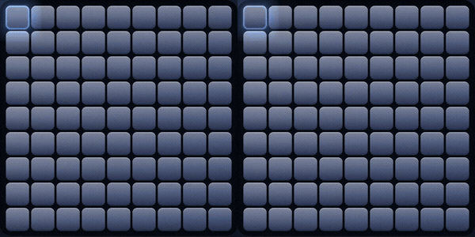

# Interaction polish: combining Runesweeper and Minesweeper Noir

Runesweeper's compact console, chrome rim, red LEDs, plastic face, classic palette switch,
XP rules and cross-platform packaging are the foundation. Minesweeper Noir contributed the
stronger interaction details: responsive lighting, readable expanding clears, and quieter
result presentation. This pass adapts those details to Runesweeper's own palette and renderer.

| Before | After | Why |
| --- | --- | --- |
| Exact selector, but no continuous light | Keep the selector exact; add a subtle pointer lamp on a 160 ms render-clock spring | Preserve targeting while making the material respond to the pointer |
| Covers swell and fade over revealed cells | Recess cells immediately; run a 250 ms light wave underneath stationary numbers | Never delay reading the board |
| A new reveal interrupts the previous ripple | Keep each pointer-authored wave until its sequence finishes | Rapid clicks stay fluid |
| Victory moves numbers and immediately opens the name dialog | Numbers stay still; keep gold flags, stars and aura; wait 800 ms before asking for a name | Let the win register without obscuring information |
| Banner overlaps the board and repeats restart instructions | Reserve one short result line below the field | No covered cells or layout shift |
| First-run hint and How to Play | Assume an experienced player; keep Game and a direct About button | Save attention |
| Some keyboard actions still trigger reveal effects | Keyboard reveals, flags, targeting and reset land immediately | Keep repeated actions fast |
| Spatial shader slots remain under Reduce Motion | Omit the lamp, shockwave, blast, sparkles and aura; retain legible state changes | Honor the system Reduce Motion setting |
| Loss heat depends on unrelated frames to keep cooling | Explicit finite glow sampling, ending at 1.2 seconds | Smooth cooling, then idle sleep |

## Visual comparison

Left: `main` at `837b619`. Right: this interaction pass. Both open the same legal seeded
Beginner field. The board crops are aligned so the lighting and expanding clear can be compared.



The full current game and its shader treatment remain visible in the README screenshots.

## Validation

- `cargo test --locked`: 29 passing tests, including actual Rune pointer/key handlers,
  Live-only hover updates, immediate and stationary numbers, overlapping reveal waves,
  record timing/cancellation, stable result geometry, reduced motion, and the 999-second cap.
- `cargo clippy --all-targets --locked -- -D warnings`: passes.
- Release build: passes on macOS arm64.
- Rune motion gate: hover/flood, keys, a legal complete win, loss, and reduced motion all clear.
  The keyboard and targeting cuts are authored explicitly on their owning elements; no gate
  allowlist is used.
- `src/game.rs` is unchanged from `main`: its latest XP gameplay fixes remain intact.

Reproduce the lighting/flood run:

```sh
cargo build --release --locked
RUNE_MOTION_GATE=lighting.gate.txt target/release/runesweeper \
  --scene beginner --script scripts/lighting.json --size 330x542 \
  --video lighting.mp4 --duration 3
```

**Animation review: approve for the verified native Mac scope.** Frequent game actions are
immediate; the pointer spring is interruptible, reveal waves are finite, and rare shader
flourishes have explicit lifetimes. Reduced motion keeps the information legible.

Native Windows/Linux, browser input and screen-reader speech were not exercised locally;
platform builds and tests remain covered by the repository's existing CI workflow.
